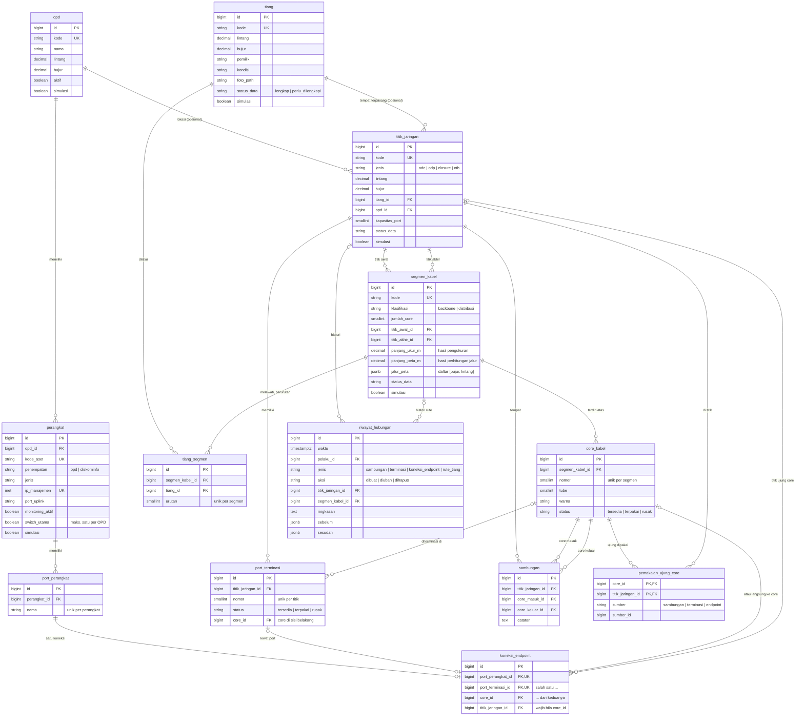
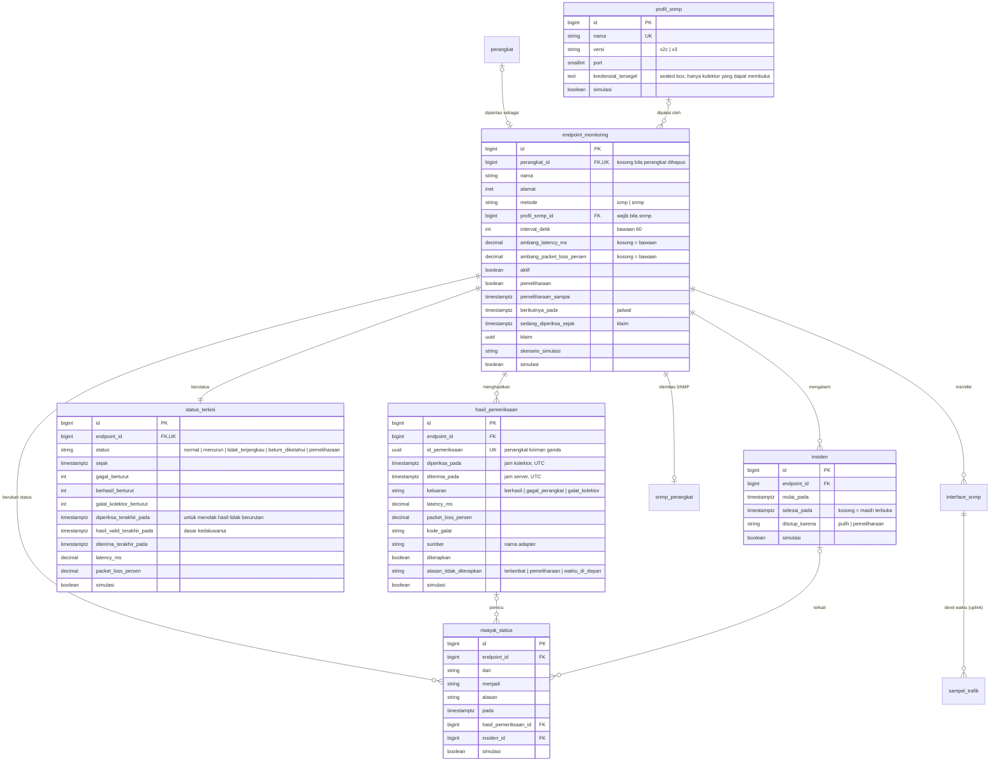
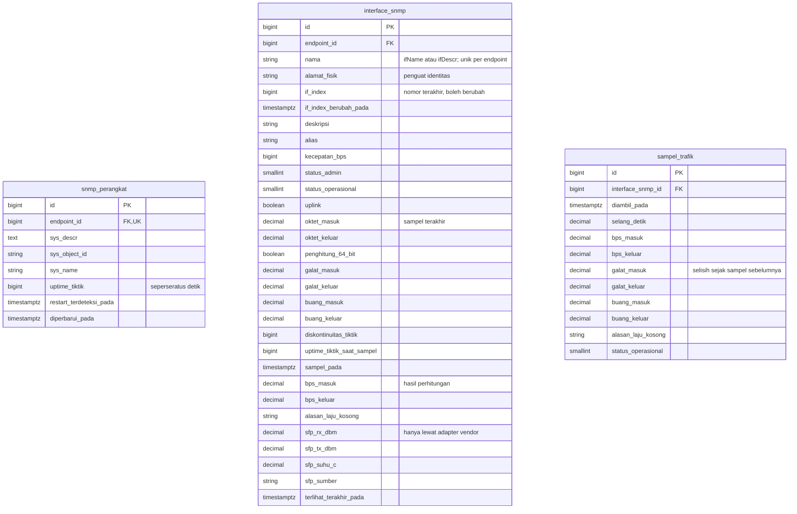
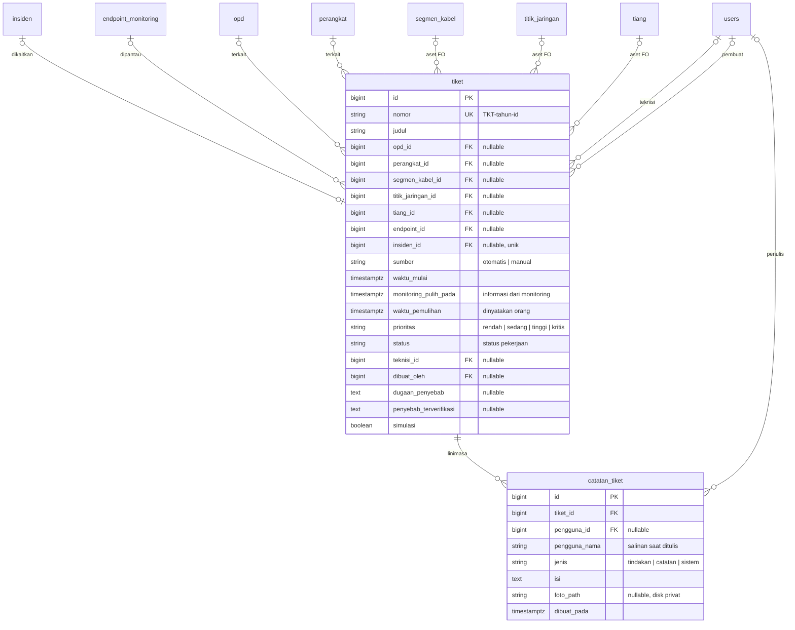
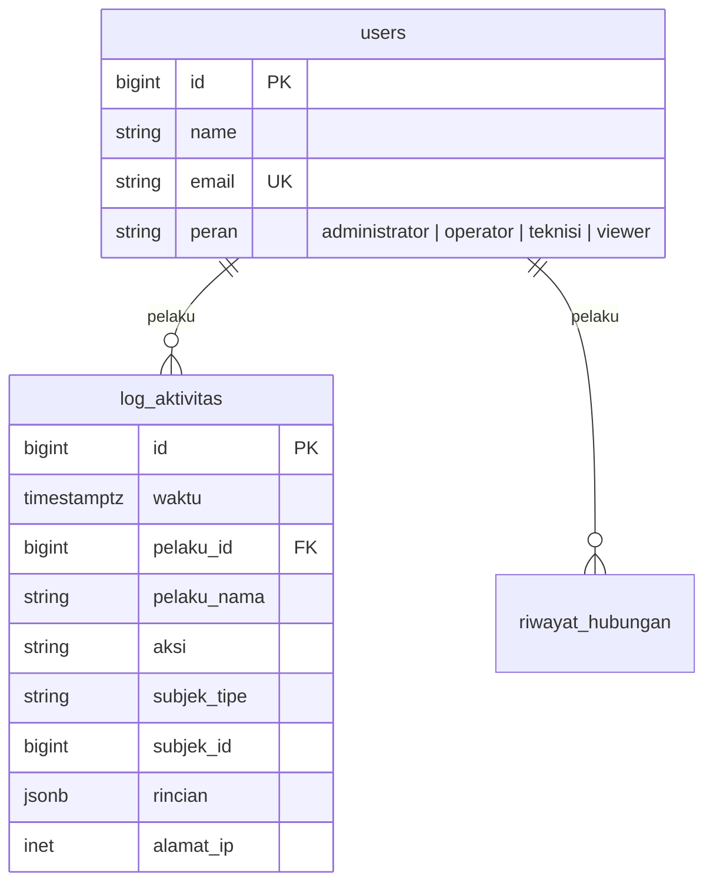

# Diagram Relasi Database

Keadaan setelah Tahap 6c (tiket gangguan). Diagram ditulis dalam Mermaid; tampil
langsung di GitHub, GitLab, dan pratinjau Markdown VS Code.

Tabel bawaan kerangka kerja (`sessions`, `cache`, `jobs`, dan sejenisnya)
tidak digambar.

## Inventaris dan hubungan jaringan



## Monitoring



Tabel data SNMP (semua metrik boleh `NULL`, artinya "Tidak tersedia"):



`hasil_pemeriksaan` juga memuat `keluaran_snmp`, `kode_galat_snmp`, dan
`pesan_snmp`; `status_terkini` memuat `snmp_keluaran`, `snmp_kode_galat`,
`snmp_gagal_berturut`, dan `snmp_berhasil_terakhir_pada`. Keluaran SNMP `NULL`
berarti SNMP tidak dicoba.

`detak_kolektor` berdiri sendiri (tanpa relasi): satu baris per proses kolektor
(`nama` = host dan nomor proses, unik), berisi `adapter`, `simulasi`,
`mulai_pada`, `detak_pada`, `putaran`, dan `diperiksa_putaran_terakhir`.
Diperbarui tiap putaran dan dibaca dashboard untuk menilai kesehatan kolektor;
baris yang lebih tua dari sehari dihapus.

Constraint monitoring yang dijaga database:
| Aturan | Dijaga oleh |
|---|---|
| Paling banyak satu insiden terbuka per endpoint | Indeks unik parsial `insiden_satu_terbuka_per_endpoint` |
| Hasil yang sama tidak tersimpan dua kali | Unique `hasil_pemeriksaan.id_pemeriksaan` |
| Satu baris status per endpoint; satu endpoint per perangkat | Unique `status_terkini.endpoint_id`, `endpoint_monitoring.perangkat_id` |
| Endpoint SNMP wajib punya profil; profil yang dipakai tidak dapat dihapus | Check `endpoint_monitoring_snmp_butuh_profil`, foreign key `RESTRICT` |
| Hasil yang tidak diterapkan selalu punya alasan, dan sebaliknya | Check `hasil_pemeriksaan_alasan_konsisten` |
| Riwayat selalu mencatat perubahan (dari ≠ menjadi) | Check `riwayat_status_status_valid` |
| Nilai status, keluaran, metode, dan versi SNMP hanya yang dikenal | Check per kolom |

Semua kolom waktu monitoring bertipe `timestamptz`, dan sesi database memakai
zona waktu UTC.

## Tiket gangguan



| Aturan | Dijaga oleh |
|---|---|
| Paling banyak satu tiket otomatis terbuka per endpoint | Indeks unik parsial `tiket_satu_otomatis_terbuka_per_endpoint` (`sumber = 'otomatis'`, status bukan selesai/dibatalkan) |
| Satu insiden paling banyak pada satu tiket | `insiden_id` unik |
| Tiket selesai harus punya waktu pemulihan | Check `tiket_selesai_butuh_pemulihan` |
| Waktu pemulihan tidak sebelum waktu mulai | Check `tiket_pemulihan_setelah_mulai` |
| Paling banyak satu aset FO per tiket | Check `tiket_satu_aset_fo` |
| Sumber, prioritas, status, dan jenis catatan hanya yang dikenal | Check per kolom |
| Tiket simulasi berjudul `[SIMULASI]` | Check `tiket_simulasi_berlabel` |
| Catatan tiket tidak diubah | Model menolak pembaruan |

Semua kunci asing tiket ke objek lain `ON DELETE SET NULL`: tiket adalah
catatan pekerjaan dan tetap ada walaupun perangkat, kabel, atau pengguna yang
dirujuknya dihapus. Status tiket tidak punya hubungan apa pun dengan
`status_terkini`; pemulihan monitoring hanya mengisi `monitoring_pulih_pada`.

## Pengguna dan log



## Cara membaca model koneksi

```
perangkat ── port_perangkat ══ koneksi_endpoint ══ port_terminasi ── core ─┐
                                                                           │ segmen kabel
              core ── sambungan ── core ─────────── core ── sambungan ── core
                       (di titik)                            (di titik)
```

- **Segmen kabel** membentang di antara dua titik jaringan. Backbone atau
  distribusi adalah kolom `klasifikasi`, bukan tabel terpisah.
- **Tiang** dan segmen berhubungan banyak-ke-banyak lewat `tiang_segmen`, yang
  menyimpan `urutan` tiang dari titik awal ke titik akhir.
- Setiap **core** punya dua ujung: di titik awal dan di titik akhir segmennya.
  Di tiap ujung, core dapat:
  - disambung ke core lain (`sambungan`),
  - diterminasi ke port (`port_terminasi.core_id`), atau
  - dihubungkan langsung ke port perangkat (`koneksi_endpoint.core_id`).
- **Port terminasi** punya sisi belakang (satu core) dan sisi depan (satu
  koneksi endpoint ke port perangkat).

## Pencegahan pemakaian ganda

| Aturan | Dijaga oleh |
|---|---|
| Satu ujung core dipakai paling banyak sekali, lintas sambungan, terminasi, dan koneksi endpoint | Primary key `pemakaian_ujung_core (core_id, titik_jaringan_id)`; barisnya diisi trigger `catat_pemakaian_ujung_core` pada ketiga tabel |
| Core tidak disambung ke dirinya sendiri | Check `sambungan_core_berbeda` |
| Satu port perangkat hanya punya satu koneksi | Unique `koneksi_endpoint.port_perangkat_id` |
| Satu port terminasi hanya terhubung ke satu port perangkat | Unique `koneksi_endpoint.port_terminasi_id` |
| Satu port terminasi hanya menerima satu core | Kolom tunggal `port_terminasi.core_id` |
| Koneksi endpoint menuju tepat satu sasaran (port atau core) | Check `koneksi_endpoint_satu_sasaran` |
| Titik awal dan akhir segmen berbeda | Check `segmen_kabel_ujung_berbeda` |
| Satu tiang tidak muncul dua kali di rute satu segmen; urutan tidak kembar | Unique `(segmen_kabel_id, tiang_id)` dan `(segmen_kabel_id, urutan)` |
| Objek yang masih terhubung tidak dapat dihapus | Foreign key `RESTRICT` dari sambungan, port, dan koneksi |

Aturan berikut dijaga di aplikasi (`App\Fo\LayananHubungan` dan
`App\Validasi\AturanFo`), belum di database:

- core hanya boleh dipakai di titik yang menjadi ujung segmennya;
- core atau port berstatus rusak tidak dapat dihubungkan;
- titik awal/akhir segmen, jumlah core, dan kapasitas port tidak dapat diubah
  bila perubahan itu memutus hubungan yang sudah tercatat;
- kolom `status` core dan port (`tersedia`/`terpakai`) diturunkan dari hubungan
  yang tercatat setiap kali hubungan berubah.

## Dua panjang kabel

| Kolom | Sumber | Diisi oleh |
|---|---|---|
| `panjang_ukur_m` | Pengukuran lapangan (OTDR, meteran) | Pengguna |
| `panjang_peta_m` | Jumlah jarak antar-titik `jalur_peta` (rumus haversine) | Aplikasi, setiap kali jalur berubah; tidak dapat diisi manual |

Selisih keduanya wajar: jalur peta tidak memuat lendutan kabel, cadangan
(slack), dan naik-turun tiang.

## Kelengkapan data

`status_data` dihitung ulang setiap kali objek disimpan:

| Objek | Wajib untuk disimpan | Wajib untuk "Lengkap" |
|---|---|---|
| Tiang | kode | koordinat, pemilik, kondisi |
| Titik jaringan | kode, jenis | lokasi (koordinat, tiang, atau OPD); kapasitas port kecuali closure |
| Segmen kabel | kode | klasifikasi, jumlah core, titik awal, titik akhir, panjang hasil pengukuran, jalur peta |
